# Enterprise Amazon EKS Platform using Terraform

## Project Overview

Provisioned an enterprise-grade Amazon Elastic Kubernetes Service (Amazon EKS) platform on AWS using Terraform Infrastructure as Code (IaC). Designed and deployed a highly available Kubernetes environment with a custom Amazon VPC, public and private networking, IAM least-privilege access controls, managed worker nodes, remote Terraform state, and Kubernetes cluster validation.

---

## Architecture

- Amazon VPC
- Public Subnets
- Private Subnets
- Internet Gateway
- NAT Gateway
- Public Route Table
- Private Route Table
- Amazon EKS Control Plane
- Amazon EKS Managed Node Group
- IAM Roles
- Security Groups
- Amazon S3 Remote Terraform State
- kubectl Cluster Management

---

## Build

- Amazon VPC
- Internet Gateway
- NAT Gateway
- Public Route Table
- Private Route Table
- Public Subnet A
- Public Subnet B
- Private Subnet A
- Private Subnet B
- Amazon EKS Cluster
- Amazon EKS Managed Node Group
- IAM Cluster Role
- IAM Node Role
- Security Groups
- Amazon S3 Remote State Backend

---

## Configuration

- Terraform Modular Architecture
- Terraform Remote State
- Native S3 State Locking
- Kubernetes Version 1.33
- Private Worker Nodes
- Managed Node Group
- Auto Scaling Configuration
- Least Privilege IAM Roles
- Route Table Associations
- Kubernetes Subnet Tagging
- kubectl Configuration

---

## Implementation

- Provisioned enterprise AWS infrastructure using Terraform Infrastructure as Code.
- Implemented modular Terraform architecture for reusable infrastructure deployments.
- Configured Amazon S3 remote Terraform state with native state locking.
- Designed a secure multi-subnet VPC architecture across multiple Availability Zones.
- Deployed Amazon EKS Control Plane.
- Provisioned Amazon EKS Managed Node Group.
- Implemented IAM least-privilege access controls for Kubernetes administration.
- Configured secure networking using Security Groups, Route Tables, Internet Gateway, and NAT Gateway.
- Validated Kubernetes cluster health using kubectl.
- Verified worker node registration and Kubernetes system services.

---

## Business Impact

Built a secure, scalable, and highly available Kubernetes platform that reduces manual infrastructure provisioning through Infrastructure as Code, strengthens organizational security through least-privilege access controls, and provides a repeatable enterprise-ready foundation for deploying containerized applications.

---

## Technologies

### Cloud

- AWS
- Amazon EKS
- Amazon VPC
- Amazon EC2
- IAM
- Amazon S3
- Internet Gateway
- NAT Gateway
- Security Groups

### Infrastructure as Code

- Terraform

### Container Orchestration

- Kubernetes
- kubectl

### Operating System

- Linux

---

# Repository Structure

```text
Aws-Eks-Cluster/
│
├── environments/
│   └── dev/
│       ├── backend.tf
│       ├── main.tf
│       ├── variables.tf
│       └── outputs.tf
│
├── modules/
│   ├── vpc/
│   └── eks/
│
├── screenshots/
│
├── diagrams/
│
└── README.md
```

---

# Project Screenshots

---

## Amazon EKS Cluster

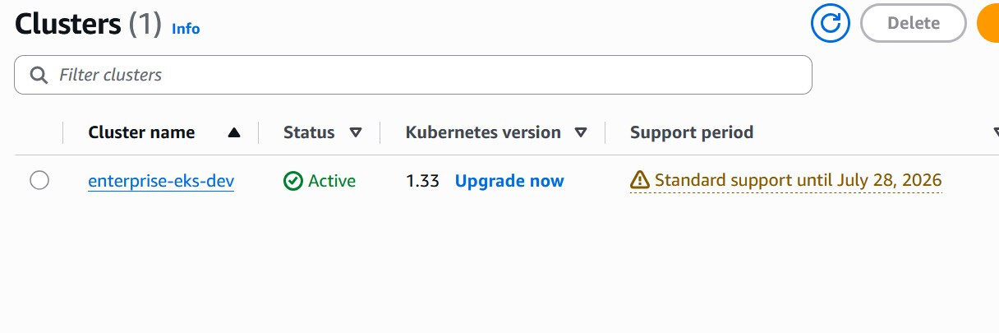

---

## Managed Node Group

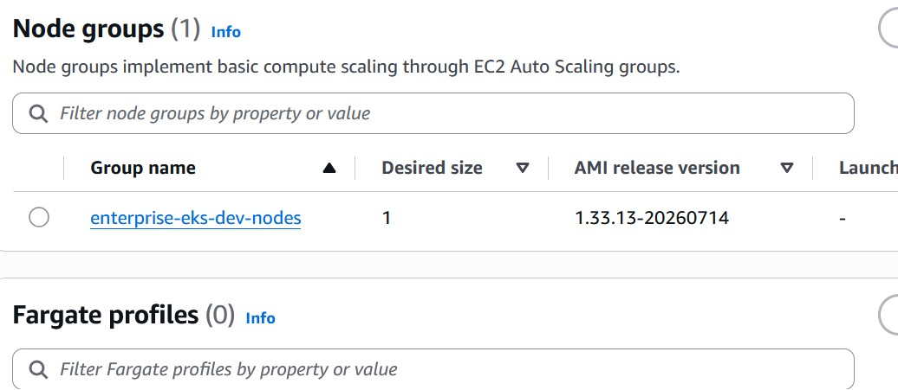

---

## Compute Nodes

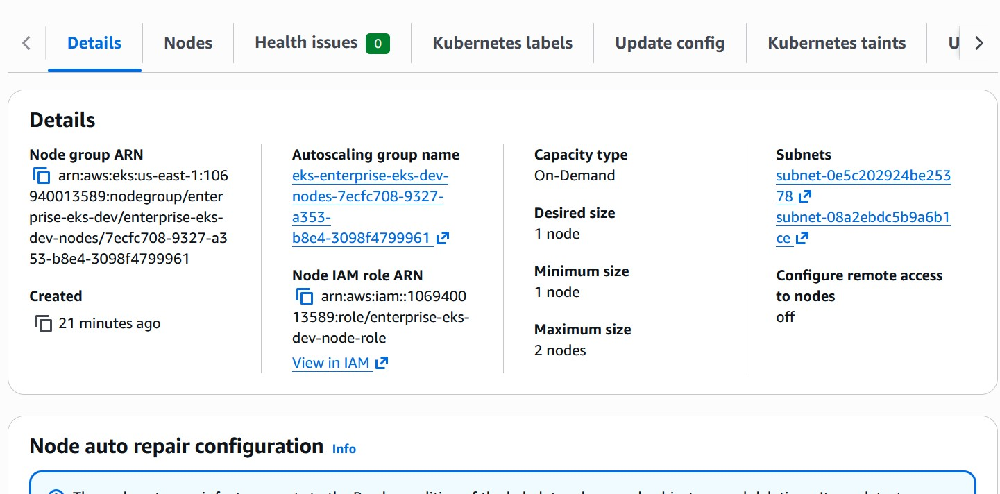

---

## Amazon VPC

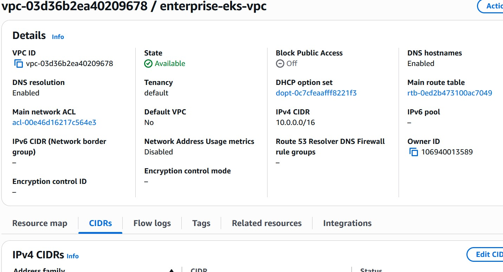

---

## Public & Private Subnets

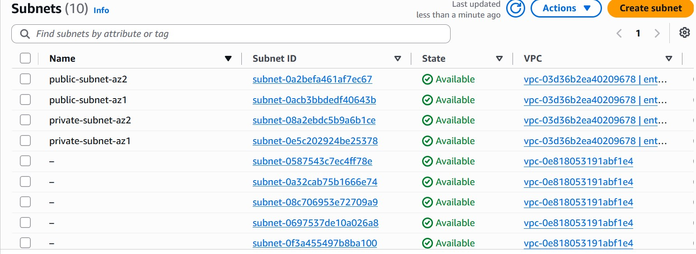

---

## Internet Gateway

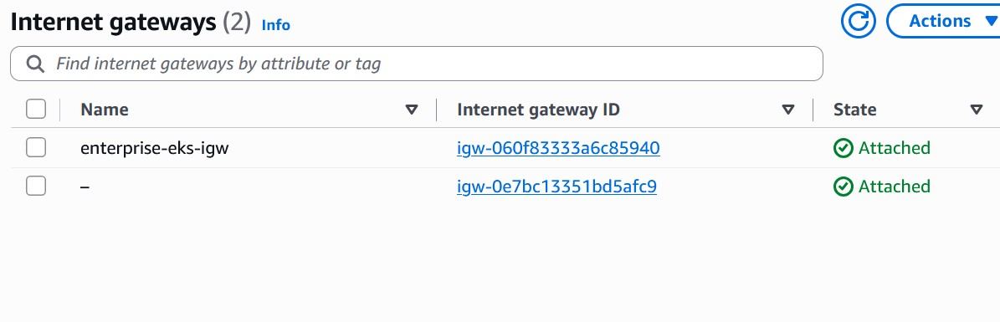

---

## NAT Gateway

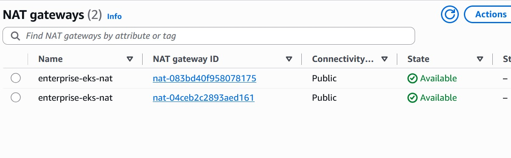

---

## Route Tables

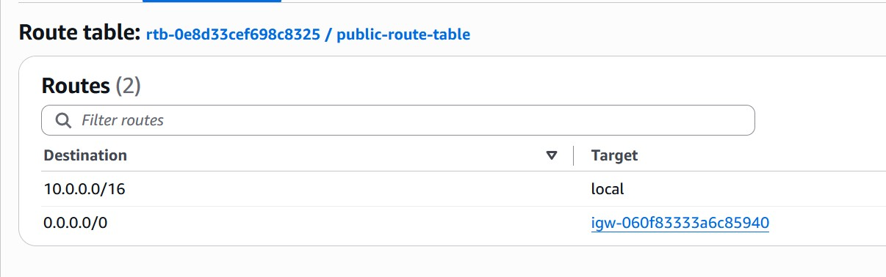

---

## Security Groups

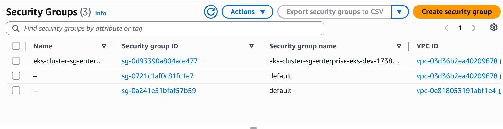

---

## IAM Roles

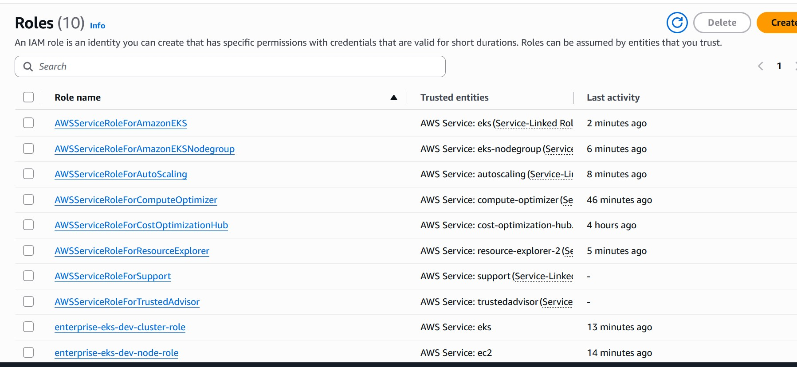

---

## Amazon S3 Remote State

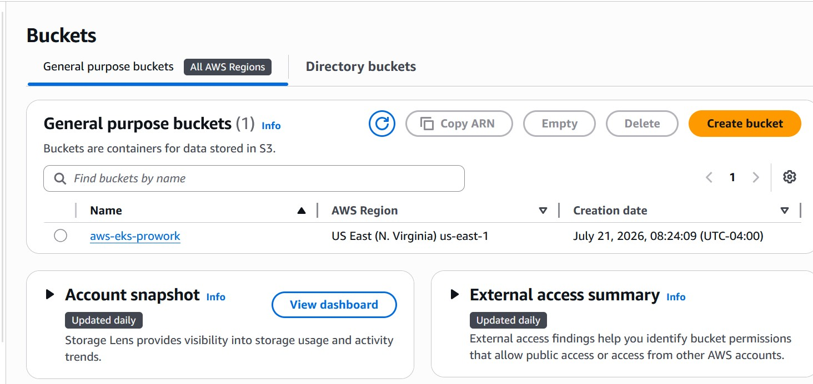

---

## Terraform Deployment

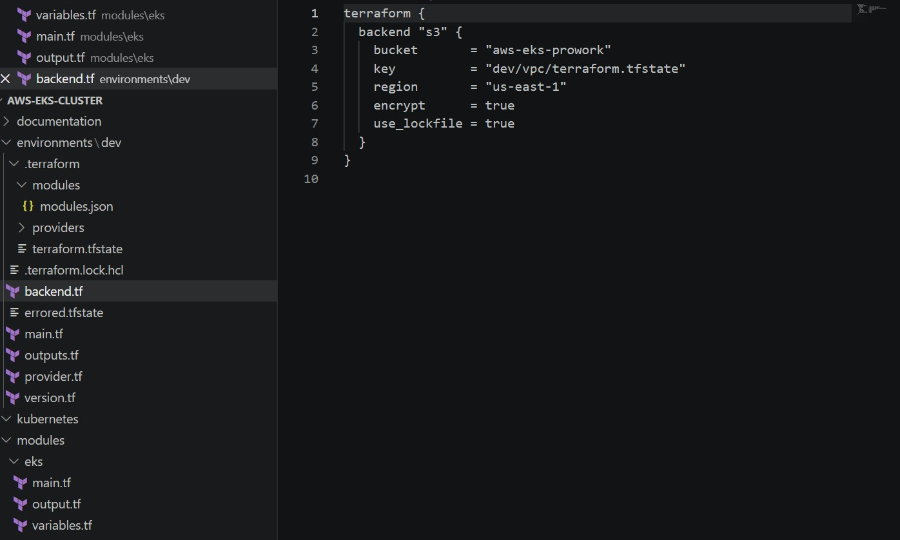

---

## Kubernetes Validation

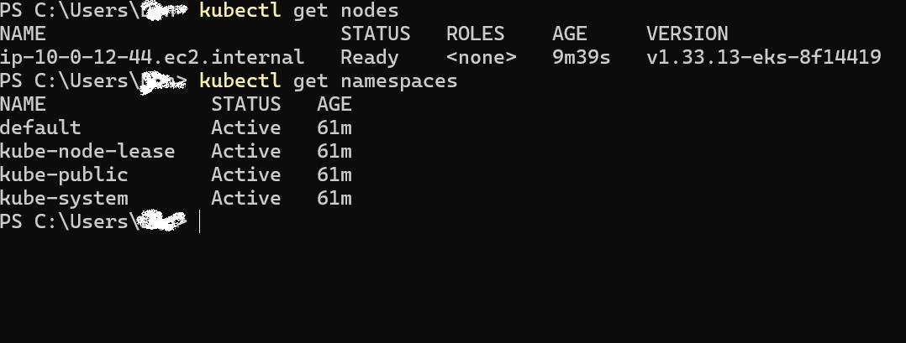

---

# Key Outcomes

- Enterprise Kubernetes Platform
- Infrastructure as Code (IaC)
- Highly Available Networking
- Secure IAM Architecture
- Private Worker Nodes
- Amazon EKS Managed Cluster
- Terraform Remote State
- Kubernetes Cluster Validation
- Production-Ready Platform Foundation
